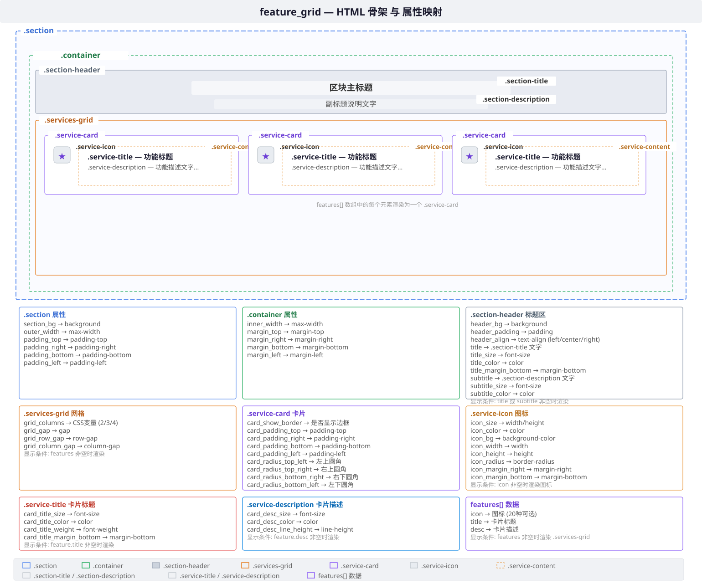

# feature_grid 内容区模式参考

### 1、HTML 骨架

```html
<!-- ===== 功能特色网格 ===== -->
<section class="section" style="">
    <div class="container" style="">
        <div class="section-header">                        <!-- 标题区（可选） -->
            <h2 class="section-title" style="">区块标题</h2>
            <p class="section-description" style="">副标题说明</p>
        </div>
        <div class="services-grid">                         <!-- 卡片网格 -->
            <div class="service-card" style="">              <!-- 单个卡片 × N -->
                <div class="service-icon">                  <!-- 图标 -->
                    <svg>...</svg>
                </div>
                <div class="service-content">               <!-- 卡片文字 -->
                    <h3 class="service-title">功能标题</h3>
                    <p class="service-description">功能描述</p>
                </div>
            </div>
            <!-- ...更多 .service-card -->
        </div>
    </div>
</section>
```



*上图：feature_grid HTML 骨架的层级结构。section → container → .section-header（标题区）+ .services-grid（卡片网格，含 3 张 .service-card 示例）。*

**feature_grid 使用 `.section-header`** 作为标题区，与 `section_title` 共用该模式。`.services-grid` 内每个 `features[]` 元素渲染为一张 `.service-card`。

### 2、内容区字段

#### 2.1 `.section` / `.container`（共享字段）

与所有 Block 相同的四层结构。外层 section、内层 container，详见 [block-structure.md](../../template-new-block/reference/block-structure.md)。

| key | label | type | CSS 属性 | default | 说明 |
|-----|-------|------|----------|---------|------|
| `section_bg` | 外层背景色 | color | `background` | `""` | section 背景色 |
| `outer_width` | 外层宽度 | text | `max-width` | `""` | 如 `1200px`（留空使用全局宽度） |
| `padding_top` | 上内边距 | text | `padding-top` | `"1rem"` | |
| `padding_right` | 右内边距 | text | `padding-right` | `""` | |
| `padding_bottom` | 下内边距 | text | `padding-bottom` | `"1rem"` | |
| `padding_left` | 左内边距 | text | `padding-left` | `""` | |
| `inner_width` | 内层内容区宽度 | text | `max-width` | `""` | `.container` 的 max-width |
| `margin_top` | 外层上外边距 | text | `margin-top` | `""` | |
| `margin_right` | 外层右外边距 | text | `margin-right` | `""` | |
| `margin_bottom` | 外层下外边距 | text | `margin-bottom` | `""` | |
| `margin_left` | 外层左外边距 | text | `margin-left` | `""` | |

#### 2.2 `.section-header` — 标题区容器

**作用：** 模块标题 + 副标题的容器。仅当 `title` 或 `subtitle` 非空时渲染整个标题区。

**内联style中自定义的css属性：** background、padding、text-align

| key | label | type | CSS 属性 | default | 说明 |
|-----|-------|------|----------|---------|------|
| `header_bg` | 标题区背景色 | color | `background` | `""` | 如 `#f7f8fa` |
| `header_padding` | 标题区内边距 | text | `padding` | `""` | 统一四边内边距，如 `2rem` |
| `header_align` | 标题区文字排版 | select | `text-align` | `""` | `left` / `center` / `right` |

#### 2.3 `.section-title` — 区块主标题

**作用：** 模块的主标题，对应 `title` 字段。留空不渲染。

**内联style中自定义的css属性：** font-size、color、margin-bottom

| key | label | type | CSS 属性 | default | 说明 |
|-----|-------|------|----------|---------|------|
| `title_size` | 标题字号 | text | `font-size` | `""` | 如 `2rem` |
| `title_color` | 标题颜色 | color | `color` | `""` | 如 `#1a1a2e` |
| `title_margin_bottom` | 标题下外边距 | text | `margin-bottom` | `""` | 标题到副标题的距离 |

#### 2.4 `.section-description` — 区块副标题

**作用：** 主标题下方的补充说明，对应 `subtitle` 字段。留空不渲染。

**内联style中自定义的css属性：** font-size、color

| key | label | type | CSS 属性 | default | 说明 |
|-----|-------|------|----------|---------|------|
| `subtitle_size` | 副标题字号 | text | `font-size` | `""` | 如 `1.125rem` |
| `subtitle_color` | 副标题颜色 | color | `color` | `""` | 如 `#64748b` |

#### 2.5 `.services-grid` — 卡片网格容器

**作用：** CSS Grid 容器，自动排列 `.service-card`。列数和间距通过以下字段配置。

**内联style中自定义的css属性：** gap、row-gap、column-gap

| key | label | type | CSS 属性 | default | 说明 |
|-----|-------|------|----------|---------|------|
| `grid_columns` | 网格列数 | select | — | `"3"` | `2` / `3` / `4`，控制每行卡片数 |
| `grid_gap` | 卡片间距 | text | `gap` | `""` | 统一控制行列间距，如 `1.5rem` |
| `grid_row_gap` | 行间距 | text | `row-gap` | `""` | 仅控制上下行间距，如 `2rem` |
| `grid_column_gap` | 列间距 | text | `column-gap` | `""` | 仅控制左右列间距，如 `1.5rem` |

#### 2.6 `.service-card` — 单个功能卡片

**作用：** 图标 + 标题 + 描述的功能卡片。`features[]` 数组中的每个元素渲染一张卡片。

**内联style中自定义的css属性：** border、padding、border-radius

| key | label | type | CSS 属性 | default | 说明 |
|-----|-------|------|----------|---------|------|
| `card_show_border` | 显示卡片边框 | select | `border` | `""` | `"0"` = 隐藏边框；空 = 显示 |
| `card_padding_top` | 卡片上内边距 | text | `padding-top` | `"2rem"` | |
| `card_padding_right` | 卡片右内边距 | text | `padding-right` | `"1.5rem"` | |
| `card_padding_bottom` | 卡片下内边距 | text | `padding-bottom` | `"2rem"` | |
| `card_padding_left` | 卡片左内边距 | text | `padding-left` | `"1.5rem"` | |
| `card_radius_top_left` | 卡片左上圆角 | text | `border-radius` | `"12px"` | 四个角独立控制 |
| `card_radius_top_right` | 卡片右上圆角 | text | `border-radius` | `"12px"` | |
| `card_radius_bottom_right` | 卡片右下圆角 | text | `border-radius` | `"12px"` | |
| `card_radius_bottom_left` | 卡片左下圆角 | text | `border-radius` | `"12px"` | |

#### 2.7 `.service-icon` — 图标

**作用：** SVG 图标容器，根据 `features[].icon` 字段渲染 20 种内联图标之一。

**内联style中自定义的css属性：** width、height、background-color、border-radius、margin

| key | label | type | CSS 属性 | default | 说明 |
|-----|-------|------|----------|---------|------|
| `icon_size` | 图标大小 | text | `width` / `height` | `""` | 同时控制 SVG 宽高，如 `24px` |
| `icon_color` | 图标颜色 | color | `color` | `""` | SVG 继承 `currentColor`，设置此值改变图标颜色 |
| `icon_bg` | 图标背景色 | color | `background-color` | `""` | 图标容器背景色，如 `#e8f4fd` |
| `icon_width` | 图标区宽度 | text | `width` | `""` | 图标容器宽度，如 `48px` |
| `icon_height` | 图标区高度 | text | `height` | `""` | 图标容器高度，如 `48px` |
| `icon_radius` | 图标圆角 | text | `border-radius` | `""` | 如 `8px` 或 `50%`（圆形） |
| `icon_margin_right` | 图标右外边距 | text | `margin-right` | `""` | 图标到 `.service-content` 文字区的间距 |
| `icon_margin_bottom` | 图标下外边距 | text | `margin-bottom` | `""` | 图标到下方元素的间距 |

#### 2.8 `.service-title` — 卡片标题

**作用：** 功能卡片的标题文字，对应 `features[].title`。

**内联style中自定义的css属性：** font-size、color、font-weight、margin-bottom

| key | label | type | CSS 属性 | default | 说明 |
|-----|-------|------|----------|---------|------|
| `card_title_size` | 卡片标题字号 | text | `font-size` | `""` | 如 `1.125rem` |
| `card_title_color` | 卡片标题颜色 | color | `color` | `""` | 如 `#1a1a2e` |
| `card_title_weight` | 卡片标题字重 | select | `font-weight` | `""` | `400` / `500` / `600` / `700` |
| `card_title_margin_bottom` | 标题下外边距 | text | `margin-bottom` | `""` | 标题到描述文字的距离 |

#### 2.9 `.service-description` — 卡片描述

**作用：** 功能卡片的描述文字，对应 `features[].desc`。

**内联style中自定义的css属性：** font-size、color、line-height

| key | label | type | CSS 属性 | default | 说明 |
|-----|-------|------|----------|---------|------|
| `card_desc_size` | 卡片描述字号 | text | `font-size` | `""` | 如 `0.95rem` |
| `card_desc_color` | 卡片描述颜色 | color | `color` | `""` | 如 `#64748b` |
| `card_desc_line_height` | 卡片描述行高 | text | `line-height` | `""` | 如 `1.6` |

#### 2.10 数据字段（list 子项：`features`）

| key | label | type | 说明 |
|-----|-------|------|------|
| `features[].icon` | 图标 | select | 20 种可选：circuit / code / structure / sensor / interactive / audio / cpu / settings / shield / zap / wifi / globe / package / tool / bar-chart / monitor / camera / light / bluetooth / touch |
| `features[].title` | 标题 | text | 卡片标题，渲染为 `.service-title` |
| `features[].desc` | 描述 | textarea | 卡片描述，渲染为 `.service-description` |

---

### 3、feature_grid 字段总览

| group | 包含字段 |
|-------|---------|
| section 层 | `section_bg`、`outer_width`、`padding_top`、`padding_right`、`padding_bottom`、`padding_left` |
| container 层 | `inner_width`、`margin_top`、`margin_right`、`margin_bottom`、`margin_left` |
| 标题区容器 | `header_bg`、`header_padding`、`header_align` |
| 区块主标题 | `title`、`title_size`、`title_color`、`title_margin_bottom` |
| 区块副标题 | `subtitle`、`subtitle_size`、`subtitle_color` |
| 网格容器 | `grid_columns`、`grid_gap`、`grid_row_gap`、`grid_column_gap` |
| 卡片样式 | `card_show_border`、`card_padding_top`、`card_padding_right`、`card_padding_bottom`、`card_padding_left`、`card_radius_top_left`、`card_radius_top_right`、`card_radius_bottom_right`、`card_radius_bottom_left` |
| 图标 | `icon_size`、`icon_color`、`icon_bg`、`icon_width`、`icon_height`、`icon_radius`、`icon_margin_right`、`icon_margin_bottom` |
| 卡片标题 | `card_title_size`、`card_title_color`、`card_title_weight`、`card_title_margin_bottom` |
| 卡片描述 | `card_desc_size`、`card_desc_color`、`card_desc_line_height` |
| 数据源 | `features`（`icon`、`title`、`desc`） |

---

### 4、模板源文件位置

| 文件 | 说明 |
|------|------|
| [template.html](../../../../site_templates/dengtec/blocks/feature_grid/template.html) | Block Jinja2 模板 |
| [meta.yaml](../../../../site_templates/dengtec/blocks/feature_grid/meta.yaml) | 当前已接入的字段定义 |
| [admin_modules.js](../../../../app/static/js/admin_modules.js) | 后台编辑表单（搜索 `feature_grid`） |
| [block-structure.md](../../template-new-block/reference/block-structure.md) | 四层结构约定和共享字段定义 |
