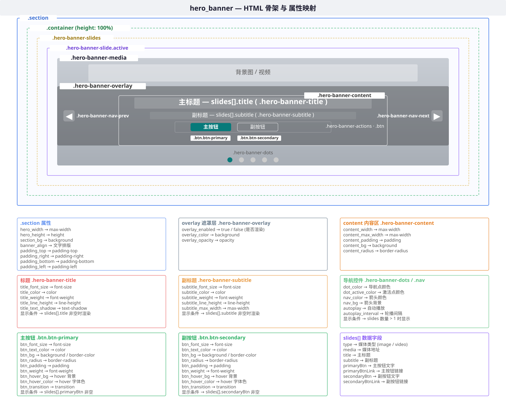

# hero_banner 内容区模式参考

### 1、HTML 骨架

```html
<!-- ===== 全屏轮播 ===== -->
<section class="section hero-banner">
    <div class="container">
        <div class="hero-banner-slides">
            <div class="hero-banner-slide active">
                <div class="hero-banner-media">                       <!-- 媒体区 -->
                <div class="hero-banner-image" style="..."></div>    <!-- 图片背景 -->
                <!-- 或 <video class="hero-banner-video" ...> -->
                </div>
                <div class="hero-banner-overlay"></div>                <!-- 遮罩层 -->
                <div class="hero-banner-content" style="">             <!-- 文字内容 -->
                <h1 class="hero-banner-title" style="">标题</h1>
                <p class="hero-banner-subtitle" style="">副标题</p>
                <div class="hero-banner-actions" style="">            <!-- 按钮区 -->
                    <a href="..." class="btn btn-primary btn-lg" style="">主按钮</a>
                    <a href="..." class="btn btn-secondary btn-lg">副按钮</a>
                </div>
                </div>
            </div>
        </div>
        <!-- 多张时显示导航点 + 左右箭头 -->
        <div class="hero-banner-dots">...</div>
        <button class="hero-banner-nav">...</button>
  </div>
</section>
```



*上图：hero_banner HTML 骨架的层级结构。红色色块=padding 区域，红色连线标注=可配置的字段属性，蓝色标注=section 层属性。*

**hero_banner 不使用 `.section-header`**。标题和副标题在 `.hero-banner-content` 内部实现。

**可见即所得的排版**：`banner_align` 字段直接决定文字块的 `left`/`top`/`transform` 定位，不需要用户写 CSS。

### 2、内容区字段

#### 2.1 `.hero-banner`（section 层覆盖）

hero_banner 覆盖了外层 section 的默认行为，使用专属的 `hero_height`/`hero_width` 字段。

**内联style中自定义的css属性：** height、max-width、background

| key | label | type | CSS 属性 | default | 说明 |
|-----|-------|------|----------|---------|------|
| `hero_width` | Banner 最大宽度 | text | `max-width` | `""` | 如 `100%`（留空=全宽） |
| `hero_height` | Banner 高度 | text | `height` | `""` | 如 `500px` 或 `77vh`（留空=CSS 默认 `77vh`） |
| `banner_align` | 文字排版 | select | — | `""` | `center`=居中 / `left`=居左 / `right`=居右，控制 `.hero-banner-content` 定位 |
| `section_bg` | 外层背景色 | color | `background` | `""` | 轮播区域背景色 |

#### 2.2 `.hero-banner-overlay` — 遮罩层

**作用：** 在媒体层之上、文字之下叠加半透明遮罩，保证文字可读性。

**内联style中自定义的css属性：** background、opacity

| key | label | type | CSS 属性 | default | 说明 |
|-----|-------|------|----------|---------|------|
| `overlay_color` | 遮罩颜色 | color | `background` | `""` | 如 `#000000`（留空=CSS 默认渐变） |
| `overlay_opacity` | 遮罩透明度 | text | `opacity` | `""` | 如 `0.4`（留空=CSS 默认） |

#### 2.3 `.hero-banner-content` — 文字内容区

**作用：** 绝对定位在 Banner 中央（或左/右）的文字容器。

**内联style中自定义的css属性：** max-width、padding、border-radius、background

| key | label | type | CSS 属性 | default | 说明 |
|-----|-------|------|----------|---------|------|
| `content_width` | 内容区宽度 | text | `max-width` | `""` | 如 `800px`（留空=全宽） |
| `content_max_width` | 内容区最大宽度 | text | `max-width` | `""` | 与 `content_width` 相同，语义更清晰 |
| `content_padding` | 内容区内边距 | text | `padding` | `""` | 如 `2rem` |
| `content_bg` | 内容区背景 | color | `background` | `""` | 如 `rgba(0,0,0,0.3)`，为文字区加半透明底色 |
| `content_radius` | 内容区圆角 | text | `border-radius` | `""` | 如 `12px` |

#### 2.4 `.hero-banner-title` — 主标题

| key | label | type | CSS 属性 | default | 说明 |
|-----|-------|------|----------|---------|------|
| `title_font_size` | 标题字号 | text | `font-size` | `""` | 如 `3.5rem` |
| `title_color` | 标题颜色 | color | `color` | `""` | 如 `#ffffff` |
| `title_weight` | 标题字重 | select | `font-weight` | `""` | `400` / `500` / `600` / `700` |
| `title_line_height` | 标题行高 | text | `line-height` | `""` | 如 `1.2` |
| `title_text_shadow` | 标题文字阴影 | text | `text-shadow` | `""` | 如 `0 2px 8px rgba(0,0,0,0.5)` |

#### 2.5 `.hero-banner-subtitle` — 副标题

| key | label | type | CSS 属性 | default | 说明 |
|-----|-------|------|----------|---------|------|
| `subtitle_font_size` | 副标题字号 | text | `font-size` | `""` | 如 `1.25rem` |
| `subtitle_color` | 副标题颜色 | color | `color` | `""` | 如 `rgba(255,255,255,0.85)` |
| `subtitle_weight` | 副标题字重 | select | `font-weight` | `""` | `300` / `400` / `500` |
| `subtitle_line_height` | 副标题行高 | text | `line-height` | `""` | 如 `1.5` |
| `subtitle_max_width` | 副标题最大宽度 | text | `max-width` | `""` | 如 `600px`，限制行长 |

#### 2.6 `.hero-banner-actions` — 按钮区

**作用：** 按钮容器，仅当 `slides[].primaryBtn` 或 `slides[].secondaryBtn` 有文字时才渲染。主按钮/副按钮的显隐由对应的文字字段控制（见 2.8 节）。

| key | label | type | CSS 属性 | default | 说明 |
|-----|-------|------|----------|---------|------|
| `btn_font_size` | 按钮字号 | text | `font-size` | `""` | 如 `1rem` |
| `btn_text_color` | 按钮文字色 | color | `color` | `""` | 如 `#ffffff` |
| `btn_bg` | 按钮背景色 | color | `background` | `""` | 如 `#067a7a` |
| `btn_radius` | 按钮圆角 | text | `border-radius` | `""` | 如 `8px` |
| `btn_padding` | 按钮内边距 | text | `padding` | `""` | 如 `12px 32px` |
| `btn_weight` | 按钮字重 | select | `font-weight` | `""` | `500` / `600` |
| `btn_hover_bg` | 按钮悬停背景 | color | `background` | `""` | hover 态背景色 |
| `btn_hover_color` | 按钮悬停字体色 | color | `color` | `""` | hover 态文字颜色 |
| `btn_transition` | 按钮过渡 | text | `transition` | `""` | 如 `all 0.3s ease` |

#### 2.7 导航控件

**作用：** 多张轮播时显示的导航点（dots）和左右箭头。

| key | label | type | CSS 属性 | default | 说明 |
|-----|-------|------|----------|---------|------|
| `dot_color` | 导航点颜色 | color | `background` | `""` | 非激活态的导航点颜色 |
| `dot_active_color` | 激活点颜色 | color | `background` | `""` | 当前 slide 的导航点颜色 |
| `nav_color` | 箭头颜色 | color | `color` | `""` | 左右箭头图标颜色 |
| `nav_bg` | 箭头背景 | color | `background` | `""` | 箭头按钮背景色 |
| `autoplay` | 自动播放 | select | — | `"true"` | `true`=自动轮播 / `false`=手动切换 |
| `autoplay_interval` | 轮播间隔 | text | — | `""` | 如 `5000`（毫秒，留空=8000ms） |

> 导航控件（dots + 左右箭头）仅当 slides 数量 > 1 时显示。

#### 2.8 数据字段（list 子项：`slides`）

| key | label | type | 说明 |
|-----|-------|------|------|
| `slides[].type` | 媒体类型 | select | `image`=图片 / `video`=视频 |
| `slides[].media` | 媒体地址 | url | 图片或视频 URL |
| `slides[].title` | 主标题 | text | 当前 slide 的标题，留空不渲染 |
| `slides[].subtitle` | 副标题 | text | 当前 slide 的副标题，留空不渲染 |
| `slides[].primaryBtn` | 主按钮文字 | text | 留空不渲染主按钮 |
| `slides[].primaryBtnLink` | 主按钮链接 | url | 主按钮跳转地址 |
| `slides[].secondaryBtn` | 副按钮文字 | text | 留空不渲染副按钮 |
| `slides[].secondaryBtnLink` | 副按钮链接 | url | 副按钮跳转地址 |

---

### 3、hero_banner 字段总览

| group | 包含字段 |
|-------|---------|
| 外层样式 | `hero_width`、`hero_height`、`section_bg`、`banner_align`、`outer_width`、`padding_*` |
| 遮罩层 | `overlay_color`、`overlay_opacity` |
| 内容区 | `content_width`、`content_max_width`、`content_padding`、`content_bg`、`content_radius` |
| 标题 | `title_font_size`、`title_color`、`title_weight`、`title_line_height`、`title_text_shadow` |
| 副标题 | `subtitle_font_size`、`subtitle_color`、`subtitle_weight`、`subtitle_line_height`、`subtitle_max_width` |
| 按钮 | `btn_font_size`、`btn_text_color`、`btn_bg`、`btn_radius`、`btn_padding`、`btn_weight`、`btn_hover_bg`、`btn_hover_color`、`btn_transition` |
| 导航 | `dot_color`、`dot_active_color`、`nav_color`、`nav_bg`、`autoplay`、`autoplay_interval` |
| 数据源 | `slides`（`type`、`media`、`title`、`subtitle`、`primaryBtn`、`primaryBtnLink`、`secondaryBtn`、`secondaryBtnLink`） |

---

### 4、模板源文件位置

| 文件 | 说明 |
|------|------|
| [template.html](../../../../site_templates/dengtec/blocks/hero_banner/template.html) | Block Jinja2 模板 |
| [meta.yaml](../../../../site_templates/dengtec/blocks/hero_banner/meta.yaml) | 当前已接入的字段定义 |
| [block-structure.md](../../template-new-block/reference/block-structure.md) | 四层结构约定和共享字段定义 |

