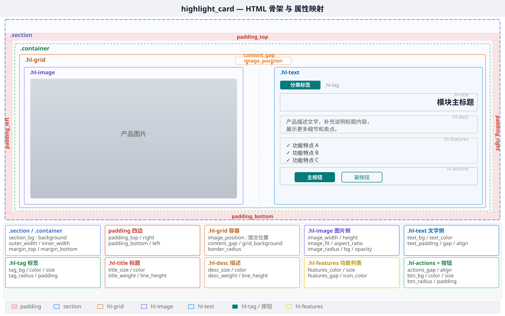

# highlight_card 内容区模式参考


### 1、HTML 骨架

```html
<!-- ===== 自定义内容区 .hl-grid ===== -->
<div class="hl-grid" style="">
    <div class="hl-image">                                      <!-- 图片侧 -->
        
    </div>
    <div class="hl-text" style="">                              <!-- 文字侧 -->
        <span class="hl-tag" style="">...</span>                <!-- 标签 -->
        <h3 class="hl-title" style="">...</h3>                  <!-- 标题 -->
        <p class="hl-desc" style="">...</p>                     <!-- 描述 -->
        <ul class="hl-features" style="">                       <!-- 功能列表 -->
            <li style="">...</li>
        </ul>
        <div class="hl-actions" style="">                       <!-- 按钮 -->
            <a href="..." class="hl-btn hl-btn--primary" style="">主按钮</a>
            <a href="..." class="hl-btn hl-btn--secondary" style="">副按钮</a>
        </div>
    </div>
</div>
```



*上图：highlight_card HTML 骨架的层级结构，左图右文双栏布局。hl-image（图片侧）+ hl-text（文字侧：标签→标题→描述→功能列表→按钮）。橙色边框=hl-grid，紫色=image，蓝色=text，绿色=按钮。image_position 控制图文左右位置。*

**highlight_card 不使用 `.section-header`**。标题区的概念由 `.hl-title` + `.hl-desc` 在内容区内部实现，见下方字段。

### 2、内容区字段

#### 2.1 `.hl-grid`

**作用：** 内容区根容器，用 Grid 将内容分为左右两栏（`.hl-image` 图片侧 + `.hl-text` 文字侧）。

**内联style中自定义的css属性：** border-radius、gap、min-height、background

| key | label | type | CSS 属性 | default | 说明 |
|-----|-------|------|----------|---------|------|
| `border_radius` | 整体圆角 | text | `border-radius` | `""` | 整个 hl-grid 的圆角，如 `12px` |
| `image_position` | 图文左右位置 | select | — | `"left"` | `left`=图左文右（默认）；`right`=添加 `.hl-grid--reverse` class |
| `content_gap` | 图文间距 | text | `gap` | `""` | `.hl-image` 与 `.hl-text` 之间的间距，如 `2rem` |
| `grid_min_height` | 最小高度 | text | `min-height` | `""` | 保证卡片高度统一，如 `400px` |
| `grid_background` | 整体背景色 | color | `background` | `""` | 图片和文字两栏的共同底色 |

#### 2.2 `.hl-image` — 图片侧

**作用：** 图片展示区，占据左栏（或右栏），承载产品图/配图。

**内联style中自定义的css属性：** width、height、object-fit、border-radius、background-color、aspect-ratio、object-position、opacity

| key | label | type | CSS 属性 | default | 说明 |
|-----|-------|------|----------|---------|------|
| `image` | 图片 | image / text | `src` | — | 图片 URL，留空不渲染 `` 标签 |
| `image_width` | 图片区宽度 | text | `width` | `""` | 如 `50%` 或 `600px` |
| `image_height` | 图片区高度 | text | `height` | `""` | 如 `400px`，留空自适应 |
| `image_aspect_ratio` | 图片区宽高比 | text | `aspect-ratio` | `""` | 如 `16/9`、`4/3` |
| `image_fit` | 图片填充方式 | select | `object-fit` | `"cover"` | `cover` / `contain` / `fill` |
| `image_position_obj` | 图片焦点位置 | select | `object-position` | `"center"` | `top` / `center` / `bottom`，配合 `cover` 指定保留区域 |
| `image_radius` | 图片圆角 | text | `border-radius` | `""` | 如 `12px 0 0 12px` |
| `image_bg` | 图片区背景色 | color | `background-color` | `""` | 图片加载前或透明图时的占位背景色 |
| `image_opacity` | 图片透明度 | text | `opacity` | `""` | 如 `0.8` |

#### 2.3 `.hl-text` — 文字侧外层

**作用：** 文字内容区，Flex 纵向排列子元素（标签 → 标题 → 描述 → 功能列表 → 按钮）。

**内联style中自定义的css属性：** background、color、padding、text-align、gap、justify-content

| key | label | type | CSS 属性 | default | 说明 |
|-----|-------|------|----------|---------|------|
| `text_bg` | 文字区背景色 | color | `background` | `""` | 如 `#f9fafb` |
| `text_color` | 文字区字体色 | color | `color` | `""` | 子元素默认继承此值 |
| `text_padding` | 文字区内边距 | text | `padding` | `"2rem"` | 统一四边内边距 |
| `text_gap` | 子元素间距 | text | `gap` | `""` | 标签/标题/描述/列表/按钮之间的统一间距 |
| `text_align` | 水平对齐 | select | `text-align` | `"left"` | `left` / `center` / `right` |
| `text_justify` | 垂直对齐 | select | `justify-content` | `"center"` | `flex-start` / `center` / `flex-end` / `space-between` |

#### 2.4 `.hl-tag` — 标签

**作用：** 分类标签（可选），位于标题上方。

**内联style中自定义的css属性：** background、color、font-size、font-weight、border-radius、padding、margin-bottom、text-transform、letter-spacing

| key | label | type | CSS 属性 | default | 说明 |
|-----|-------|------|----------|---------|------|
| `tag` | 标签文字 | text | — | `""` | 留空不渲染 |
| `tag_bg` | 标签背景色 | color | `background` | `""` | 如 `#067a7a` |
| `tag_color` | 标签字体色 | color | `color` | `""` | 如 `#ffffff` |
| `tag_size` | 标签字号 | text | `font-size` | `""` | 如 `0.75rem` |
| `tag_weight` | 标签字重 | select | `font-weight` | `""` | `400` / `500` / `600` / `700` |
| `tag_transform` | 文字变换 | select | `text-transform` | `""` | `uppercase` / `none` / `capitalize` |
| `tag_letter_spacing` | 字间距 | text | `letter-spacing` | `""` | 如 `0.05em` |
| `tag_radius` | 标签圆角 | text | `border-radius` | `""` | 如 `4px` 或 `999px`（胶囊形） |
| `tag_padding` | 标签内边距 | text | `padding` | `""` | 如 `4px 12px` |
| `tag_margin_bottom` | 标签下间距 | text | `margin-bottom` | `""` | 标签到标题的距离 |

#### 2.5 `.hl-title` — 标题

**作用：** 模块主标题，控制整个模块的显隐（留空则模块不渲染）。

**内联style中自定义的css属性：** font-size、color、font-weight、text-align、margin-bottom、line-height

| key | label | type | CSS 属性 | default | 说明 |
|-----|-------|------|----------|---------|------|
| `title` | 标题文字 | text | — | `""` | **控制整个模块显隐** |
| `title_size` | 标题字号 | text | `font-size` | `""` | 如 `1.5rem` |
| `title_color` | 标题颜色 | color | `color` | `""` | 如 `#1e293b` |
| `title_weight` | 标题字重 | select | `font-weight` | `""` | `400` / `500` / `600` / `700` |
| `title_line_height` | 标题行高 | text | `line-height` | `""` | 如 `1.3` |
| `title_align` | 标题对齐 | select | `text-align` | `""` | `left` / `center` / `right` |
| `title_margin_bottom` | 标题下间距 | text | `margin-bottom` | `""` | 标题到描述的距离 |

#### 2.6 `.hl-desc` — 描述

**作用：** 标题下方的补充说明文字。

**内联style中自定义的css属性：** font-size、color、font-weight、line-height、margin-bottom、opacity

| key | label | type | CSS 属性 | default | 说明 |
|-----|-------|------|----------|---------|------|
| `desc` | 描述文字 | textarea | — | `""` | 留空则不渲染 |
| `desc_size` | 描述字号 | text | `font-size` | `""` | 如 `1rem` |
| `desc_color` | 描述颜色 | color | `color` | `""` | 如 `#64748b` |
| `desc_weight` | 描述字重 | select | `font-weight` | `""` | 默认 `400` |
| `desc_line_height` | 描述行高 | text | `line-height` | `""` | 如 `1.6` |
| `desc_opacity` | 描述透明度 | text | `opacity` | `""` | 如 `0.8` |
| `desc_margin_bottom` | 描述下间距 | text | `margin-bottom` | `""` | 描述到功能列表的距离 |

#### 2.7 `.hl-features` — 功能点列表

**作用：** 产品卖点/特性列表，每条带 ✓ 图标。

**内联style中自定义的css属性：** color、font-size、gap、margin-bottom、line-height

| key | label | type | CSS 属性 | default | 说明 |
|-----|-------|------|----------|---------|------|
| `features` | 功能点列表 | list | — | `[]` | 每条渲染为 `<li>✓ 文本</li>`，空数组不渲染 |
| `features_color` | 功能点颜色 | color | `color` | `""` | 独立于 `text_color` |
| `features_size` | 功能点字号 | text | `font-size` | `""` | 如 `0.95rem` |
| `features_line_height` | 功能点行高 | text | `line-height` | `""` | 如 `1.5` |
| `features_gap` | 功能点间距 | text | `gap` | `""` | `<li>` 之间的间距 |
| `features_icon_color` | ✓ 图标颜色 | color | `color` | `""` | ✓ 字符的颜色 |
| `features_icon_size` | ✓ 图标字号 | text | `font-size` | `""` | ✓ 字符的字号 |
| `features_margin_bottom` | 功能列表下间距 | text | `margin-bottom` | `""` | 列表到按钮区的距离 |

#### 2.8 `.hl-actions` — 按钮区

**作用：** 按钮容器，横向排列主按钮和副按钮。

**内联style中自定义的css属性：** gap、justify-content、margin-top、flex-wrap

| key | label | type | CSS 属性 | default | 说明 |
|-----|-------|------|----------|---------|------|
| `actions_gap` | 按钮间距 | text | `gap` | `""` | 主按钮与副按钮之间的间距 |
| `actions_align` | 按钮区对齐 | select | `justify-content` | `""` | `flex-start` / `center` / `flex-end` |
| `actions_margin_top` | 按钮区上间距 | text | `margin-top` | `""` | 按钮区到功能列表的距离 |
| `actions_wrap` | 允许换行 | select | `flex-wrap` | `""` | `wrap` / `nowrap` |

#### 2.9 `.hl-btn--primary` / `.hl-btn--secondary` — 按钮

**作用：** CTA 按钮。主按钮引导核心操作，副按钮提供辅助跳转。

| key | label | type | 作用元素 | CSS 属性 | default | 说明 |
|-----|-------|------|----------|----------|---------|------|
| `primaryBtn` | 主按钮文字 | text | `.hl-btn--primary` | — | `""` | 留空不渲染 |
| `primaryLink` | 主按钮链接 | url | `.hl-btn--primary` | `href` | `""` | 按钮跳转地址，留空不渲染按钮（即使 primaryBtn 有文字） |
| `primaryLinkTarget` | 主按钮打开方式 | select | `.hl-btn--primary` | — | `""` | `""`=当前页 / `_blank`=新标签页 |
| `secondaryBtn` | 副按钮文字 | text | `.hl-btn--secondary` | — | `""` | 留空不渲染 |
| `secondaryLink` | 副按钮链接 | url | `.hl-btn--secondary` | `href` | `""` | 副按钮跳转地址，留空不渲染按钮（即使 secondaryBtn 有文字） |
| `btn_bg` | 主按钮背景色 | color | `.hl-btn--primary` | `background` | `""` | 如 `#067a7a` |
| `btn_color` | 主按钮字体色 | color | `.hl-btn--primary` | `color` | `""` | 如 `#ffffff` |
| `btn_size` | 按钮字号 | text | `.hl-btn` | `font-size` | `""` | 主/副按钮统一字号 |
| `btn_weight` | 按钮字重 | select | `.hl-btn` | `font-weight` | `""` | `400` / `500` / `600` |
| `btn_radius` | 按钮圆角 | text | `.hl-btn` | `border-radius` | `""` | 如 `6px` 或 `999px` |
| `btn_padding` | 按钮内边距 | text | `.hl-btn` | `padding` | `""` | 如 `10px 24px` |
| `btn_hover_bg` | 主按钮悬停背景 | color | `.hl-btn--primary:hover` | `background` | `""` | hover 态背景色 |
| `btn_hover_color` | 主按钮悬停字体色 | color | `.hl-btn--primary:hover` | `color` | `""` | hover 态文字颜色 |
| `btn_secondary_border` | 副按钮边框色 | color | `.hl-btn--secondary` | `border-color` | `""` | outline 样式边框颜色 |
| `btn_secondary_color` | 副按钮字体色 | color | `.hl-btn--secondary` | `color` | `""` | 副按钮文字颜色 |
| `btn_secondary_hover_bg` | 副按钮悬停背景 | color | `.hl-btn--secondary:hover` | `background` | `""` | 悬停时填充背景 |
| `btn_secondary_hover_color` | 副按钮悬停字体色 | color | `.hl-btn--secondary:hover` | `color` | `""` | 悬停时字体颜色 |
| `btn_transition` | 按钮过渡动画 | text | `.hl-btn` | `transition` | `""` | 如 `all 0.2s ease` |

---

### 3、highlight_card 字段总览

| group | 包含字段 |
|-------|---------|
| 外层样式 | `section_bg`、`outer_width`、`margin_top`、`margin_bottom`、`padding_top`、`padding_right`、`padding_bottom`、`padding_left` |
| 内层样式 | `inner_width` |
| 图文布局 | `image_position`、`border_radius`、`content_gap`、`grid_min_height`、`grid_background` |
| 图片 | `image`、`image_width`、`image_height`、`image_aspect_ratio`、`image_fit`、`image_position_obj`、`image_radius`、`image_bg`、`image_opacity` |
| 文字区 | `text_bg`、`text_color`、`text_padding`、`text_gap`、`text_align`、`text_justify` |
| 标签 | `tag`、`tag_bg`、`tag_color`、`tag_size`、`tag_weight`、`tag_transform`、`tag_letter_spacing`、`tag_radius`、`tag_padding`、`tag_margin_bottom` |
| 标题 | `title`、`title_size`、`title_color`、`title_weight`、`title_line_height`、`title_align`、`title_margin_bottom` |
| 描述 | `desc`、`desc_size`、`desc_color`、`desc_weight`、`desc_line_height`、`desc_opacity`、`desc_margin_bottom` |
| 功能列表 | `features`、`features_color`、`features_size`、`features_line_height`、`features_gap`、`features_icon_color`、`features_icon_size`、`features_margin_bottom` |
| 按钮区 | `actions_gap`、`actions_align`、`actions_margin_top`、`actions_wrap` |
| 按钮 | `primaryBtn`、`primaryLink`、`primaryLinkTarget`、`secondaryBtn`、`secondaryLink`、`btn_bg`、`btn_color`、`btn_size`、`btn_weight`、`btn_radius`、`btn_padding`、`btn_hover_bg`、`btn_hover_color`、`btn_secondary_border`、`btn_secondary_color`、`btn_secondary_hover_bg`、`btn_secondary_hover_color`、`btn_transition` |

---

### 4、模板源文件位置

| 文件 | 说明 |
|------|------|
| [template.html](../../../../site_templates/dengtec/blocks/highlight_card/template.html) | Block Jinja2 模板 |
| [meta.yaml](../../../../site_templates/dengtec/blocks/highlight_card/meta.yaml) | 当前已接入的字段定义 |
| [admin_modules.js](../../../../app/static/js/admin_modules.js) | 后台编辑表单（搜索 `highlight_card`） |
| [block-structure.md](../../template-new-block/reference/block-structure.md) | 四层结构约定和共享字段定义 |

---
