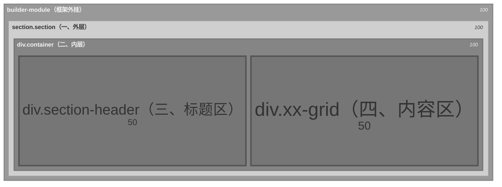

# Block 模板的结构约定速查

```html
<div class="builder-module" data-builder-module-index="2" data-builder-module-type="highlight_card"> <!-- 由 builder 框架在包装每个模块时自动注入，Block 模板不需要处理-->
  <!-- 样式走 inline style，有值才输出，空值不写让 CSS 变量兜底 -->
  <section class="section" style="">                                           <!-- 一 外层 -->                               
    <div class="container" style=""> 
      <div class="section-header">                                             <!-- 三 标题区 -->
        <h2 class="section-title">...</h2>                                     <!-- 标题 -->
        <p class="section-description">...</p>                                 <!-- 副标题/描述 -->
      </div>
      <!-- 内容区(以列表为例) -->
      <div class="hl-grid">                                                    <!-- 四 自定义内容区 -->
        <div class="hl-card">
          
          <h3>...</h3>
        </div>
      </div>
    </div>
  </section>
</div>
```
## builder-module



**Block 模板不需要写 `builder-module`**——它由框架在运行时自动外挂。

**两个 data 属性的用途：**

| 属性 | 值来源 | 用途 |
|------|--------|------|
| `data-builder-module-index` | `loop.index0`（模块在页面中的序号） | 后台 JS 通过它定位模块 DOM，实现选中高亮/拖拽排序 |
| `data-builder-module-type` | `module.type`（如 `highlight_card`） | 后台 JS 识别模块类型，打开对应的编辑表单 |

**`data-builder-module-type` 全部可选值：**

| 类型名 | 中文名 | 说明 |
|--------|--------|------|
| `hero_banner` | 轮播大图 | 全宽 Banner，支持多张轮播，含标题/副标题/按钮 |
| `section_title` | 区块标题 | 标签 + 主标题 + 描述文字 + 可选按钮 |
| `text_content` | 文本内容 | 富文本编辑器，支持 H2/H3/加粗/斜体/链接，可选双栏 |
| `highlight_card` | 高亮卡片 | 图文并排的卡片（图左文右或文左图右） |
| `feature_grid` | 功能卡片网格 | 多个功能卡片的网格布局，可控制边框/圆角/内边距 |
| `data_grid` | 数据网格 | 关联数据集（products/portfolio/posts）的卡片列表，支持分页 |
| `product_grid` | 产品网格 | 产品数据集的网格展示（简化版 data_grid） |
| `stat_counter` | 统计计数器 | 数字统计展示（如"500+ 客户"），支持多列 |
| `contact_info` | 联系方式 | 地址/电话/邮箱/工作时间等联系信息 |
| `contact_form` | 联系表单 | 用户留言表单（前端展示） |
| `process_steps` | 流程步骤 | 横向或纵向的步骤展示（数字序号或图标） |
| `logo_cloud` | Logo 云 | 合作品牌 Logo 墙，支持灰度滤镜 |
| `item_detail` | 详情展示 | 产品/案例详情页（多图轮播 + 规格参数表） |
| `item_data` | 数据集条目编辑 | **特殊类型**，仅用于数据集编辑面板，不用于页面模块 |

**后台交互（仅预览态）：**
- `.builder-module` 设置 `position: relative; cursor: pointer`，hover 时显示虚线边框
- 点击模块后加 `.builder-canvas-selected` class，显示实线高亮边框
- 所有样式和事件处理由 `app/templates/base.html` 内联 `<style>` + JS 注入

**Block 模板只需关心内层结构**——`<section class="section">` 及以下的内容。外层 wrapper 永远由框架处理。

## 一 外层 .section

模块的最外层包装器, 

| key | label | type | group | default | placeholder | CSS 属性 | 说明 |
|-----|-------|------|-------|---------|-------------|----------|------|
| `outer_width` | 外层宽度 | text | 外层样式 | `""` | 如 1200px（留空使用全局宽度） | `max-width` | 外层最大宽度。留空使用全局宽度，可设置100%左右铺满 |
| `section_bg` | 外层背景色 | color | 外层样式 | `""` | 如 #f5f7fa（留空=使用默认） | `background` | 外层背景色 |
| `margin_top` | 外层上外边距 | text | 外层样式 | `""` | 如 40px | `margin-top` | 外层外边距（四边独立，按需选用） |
| `margin_right` | 外层右外边距 | text | 外层样式 | `""` | 如 40px | `margin-right` | 同上 |
| `margin_bottom` | 外层下外边距 | text | 外层样式 | `""` | 如 40px | `margin-bottom` | 同上 |
| `margin_left` | 外层左外边距 | text | 外层样式 | `""` | 如 40px | `margin-left` | 同上 |
| `padding_top` | 上内边距 | text | 外层样式 | `"1rem"` | 如 2rem（留空=默认） | `padding-top` | 外层内边距（四边独立） |
| `padding_right` | 右内边距 | text | 外层样式 | `""` | 如 2rem（留空=默认） | `padding-right` | 同上 |
| `padding_bottom` | 下内边距 | text | 外层样式 | `"1rem"` | 如 2rem（留空=默认） | `padding-bottom` | 同上 |
| `padding_left` | 左内边距 | text | 外层样式 | `""` | 如 2rem（留空=默认） | `padding-left` | 同上 |

### 二 内层 .container

**作用：** 在模块内部限定**内容的展示宽度**，与外层解耦。

| key | label | type | group | default | placeholder | CSS 属性 | 说明 |
|-----|-------|------|-------|---------|-------------|----------|------|
| `inner_width` | 内层内容区宽度 | text | 外层样式 | `""` | 如 1200px（留空=全宽） | `max-width` | 内层最大宽度。与外层 `outer_width` 独立：外层可铺满全屏，内层如 800px 居中 |
| `inner_bg` | 内层背景色 | color | 内层样式 | `""` | 如 #ffffff（留空=透明） | `background-color` | 内层背景色（process_steps / logo_cloud 使用） |
| `inner_margin_top` | 内层上外边距 | text | 内层样式 | `""` | 如 24px | `margin-top` | 内层外边距（四边独立） |
| `inner_margin_right` | 内层右外边距 | text | 内层样式 | `""` | 如 24px | `margin-right` | 同上 |
| `inner_margin_bottom` | 内层下外边距 | text | 内层样式 | `""` | 如 24px | `margin-bottom` | 同上 |
| `inner_margin_left` | 内层左外边距 | text | 内层样式 | `""` | 如 24px | `margin-left` | 同上 |
| `inner_padding_top` | 内层上内边距 | text | 内层样式 | `"1rem"` | 如 2rem（留空=默认） | `padding-top` | 内层内边距（四边独立） |
| `inner_padding_right` | 内层右内边距 | text | 内层样式 | `""` | 如 2rem（留空=默认） | `padding-right` | 同上 |
| `inner_padding_bottom` | 内层下内边距 | text | 内层样式 | `"1rem"` | 如 2rem（留空=默认） | `padding-bottom` | 同上 |
| `inner_padding_left` | 内层左内边距 | text | 内层样式 | `""` | 如 2rem（留空=默认） | `padding-left` | 同上 |


### 三 标题区 .section-header

**作用：** 统一的区块标题区域，包含主标题和副标题。（不是所有 Block 都使用标题，视 Block 需求而定）

以下字段定义为可选扩展点——当你需要让店主在后台调整标题区样式时，按需添加到 meta.yaml 中。

| key | label | type | group | default | placeholder | CSS 属性 | 说明 |
|-----|-------|------|-------|---------|-------------|----------|------|
| `text_align` | 标题区文字排版 | select | 标题样式 | `"center"` | left=居左, center=居中, right=居右 | `text-align` | 标题区水平对齐 |
| `header_margin_top` | 标题区上外边距 | text | 标题样式 | `""` | 如 2rem | `margin-top` | 标题区外边距 |
| `header_margin_bottom` | 标题区下外边距 | text | 标题样式 | `""` | 如 2rem | `margin-bottom` | 同上 |
| `header_padding_top` | 标题区上内边距 | text | 标题样式 | `""` | 如 1rem | `padding-top` | 标题区内边距 |
| `header_padding_bottom` | 标题区下内边距 | text | 标题样式 | `""` | 如 1rem | `padding-bottom` | 同上 |

### 三-a 主标题 .section-title

**作用：** Block 主标题（控制标题区显隐：不录入主标题则整个标题区不显示）

| key | label | type | group | default | placeholder | CSS 属性 | 说明 |
|-----|-------|------|-------|---------|-------------|----------|------|
| `title_size` | 标题字号 | text | 标题样式 | `""` | 如 2rem（留空=CSS 默认） | `font-size` | 标题字号，也可命名为 `title_font_size` |
| `title_color` | 标题颜色 | color | 标题样式 | `""` | 如 #1e293b（留空=CSS 默认） | `color` | 标题颜色 |

### 三-b 副标题 .section-description

**作用：** Block 副标题（永远放在主标题下方）

| key | label | type | group | default | placeholder | CSS 属性 | 说明 |
|-----|-------|------|-------|---------|-------------|----------|------|
| `desc_size` | 副标题字号 | text | 标题样式 | `""` | 如 1rem（留空=CSS 默认） | `font-size` | 副标题字号，也可命名为 `subtitle_size`、`desc_font_size` |
| `desc_color` | 副标题颜色 | color | 标题样式 | `""` | 如 #64748b（留空=CSS 默认） | `color` | 副标题颜色，也可命名为 `subtitle_color` |


### 四 自定义内容区

**作用：** 每个 Block 的核心展示区域，结构完全由 Block 类型决定。

详见 **[内容区模式参考](content-patterns.md)**。


## 层 → 字段速查

| 层 | 对应 meta.yaml 字段 | 
|---|---|
| 一 .section | `section_bg`, `outer_width`, `margin_*`, `padding_*`, `hero_height` 等 | 
| 二 .container | `inner_width`, `inner_bg`, `inner_margin_*`, `inner_padding_*` | 
| 三 .section-header | `text_align`, `header_margin_*`, `header_padding_*` | 
| 三-a .section-title | `title_size`, `title_color`, `title_margin_*`, `title_padding_*` | 
| 三-b .section-description | `desc_size`, `desc_color`, `desc_margin_*`, `desc_padding_*` | 
| 四 自定义内容区 | 视 Block 类型而定 | 见 [content-patterns.md](content-patterns.md) |

## 参考示例

参考 meta.yaml 字段：[data_grid/meta.yaml](../../../../site_templates/dengtec/blocks/data_grid/meta.yaml)
