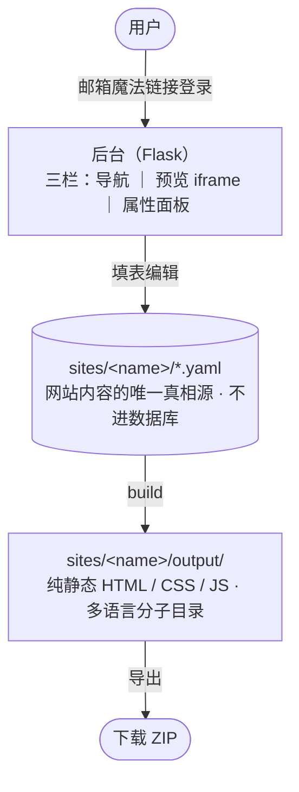

# 架构

## 是什么

用户登录后选择喜欢的主题，适当修改布局和设置，替换图片与文字，变成自己需要的网站，然后导出 HTML。

## 当前范围

### 平台提供

- 若干套设计好的主题供选择
- 存储每个用户设计的网站（YAML 文件）
- 构建并导出静态站（ZIP）

### 用户能做（典型流程）

1. 选一套主题。
2. 完善站点基本信息：favicon、主色、logo、菜单、支持的语言、站点名 + slogan。
3. 选 / 自定义各类页面的布局：
   - 1–2 套页眉 / 页脚（产品页与文章页可分开用）
   - 产品详情页、博客详情页布局
   - 产品列表页、博客列表页布局
4. 设计独立页面（如 index、关于我们）。
5. 添加产品、博客文章 —— 布局固定，只填内容。

## 端到端数据流



## 组件

| 组件 | 职责 |
| --- | --- |
| Flask 应用（`app/`） | 后台 HTTP 入口：登录、内容编辑、触发构建 / 导出 |
| 数据库（SQLAlchemy） | 只存平台级元数据：账号、站点登记、主题登记、登录 token |
| 磁盘 `sites/<name>/` | 一个网站的全部：源内容（YAML）+ 资源 + 构建产物 `output/`；name = 子域名 slug |
| builder | 把 `sites/<name>/` 源文件 + 主题 渲染成 `sites/<name>/output/` 静态站 |
| 主题 `themes/` | 访客端外观（HTML + Jinja2 + CSS），管理员上传 ZIP 安装 |
| 导出 | 把 `sites/<name>/output/` 打包成 ZIP 给用户下载（当前唯一发布方式） |

## 数据存哪里（核心原则）

数据分两层：

- **数据库 = 平台级元数据**：账号、站点登记、主题登记、登录 token。**不存网站内容，不存价格 / 会员 / 到期。**
- **磁盘 `sites/<name>/` = 网站内容**：设置、页面、数据集、翻译、资源，全是 YAML + 文件，是内容的唯一真相源；构建产物放同目录的 `output/`。

`name` = 创建时选定的子域名 slug。导出的静态站 = `sites/<name>/output/`，可直接打包带走。字段细节见 [database.md](database.md)（DB 表）与 [data-model.md](data-model.md)（磁盘结构）。

## 目录结构

```text
app/
  __init__.py        应用工厂（注册扩展、蓝图、CLI）
  core/              模型、路由、builder、主题加载、菜单、block、翻译
  templates/         后台页面（Flask template，≠ 主题）
  static/            后台 CSS / JS
themes/<name>/       一套主题（meta.yaml + layouts/ + blocks/ + i18n/<lang>/ + static/，layouts/blocks/static 语言无关，i18n/<lang>/ 按语言分整套 seed：settings.yaml + pages + data）
sites/<name>/        一个网站的全部（name = 子域名 slug，gitignored）
  *.yaml / pages/ …  源内容（设置 / 页面 / 数据集 / 翻译 / 资源）
  output/            该站生成的静态站（build 产物，导出即打包它）
instance/            SQLite 数据库（gitignored）
```

## 关键约束

- 产出永远是静态文件；后台只在编辑 / 构建时运行。
- 主题由管理员上传 ZIP 安装（本地开发可直接放 `themes/`）。
- 登录用邮箱魔法链接。
- 网站名（name）= 创建时选定，遵循子域名规则（小写字母数字 + 连字符，3–30 字符，全局唯一，排除保留字），作为站点目录名；创建后 1 个月内不可改，之后改名 = 迁移目录。

## 子系统文档

- [database.md](database.md) — 数据库表（平台级元数据）
- [data-model.md](data-model.md) — 磁盘 YAML 结构（网站内容模型）
- [themes/](themes/) — 主题开发（结构 / CSS·JS / 调用 block / 读取设置）
- [themes/blocks/](themes/blocks/) — Block 系统
- [content.md](content.md) — 用户三栏后台
- [publish.md](publish.md) — 静态生成与导出
- [i18n.md](i18n.md) — 多语言与 AI 翻译
