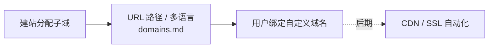

# cloud —— 托管与交付设施

子域、自定义域名、CDN / SSL 等托管侧设施。

## 文档

| 文档 | 讲什么 |
| --- | --- |
| [domains.md](domains.md) | 子域分配、slug 规则、URL 路径与多语言、预览、自定义域名 |

> CDN / SSL 自动化（证书签发、续期、provisioning）属后期，暂未单独成文。

## 工作流

