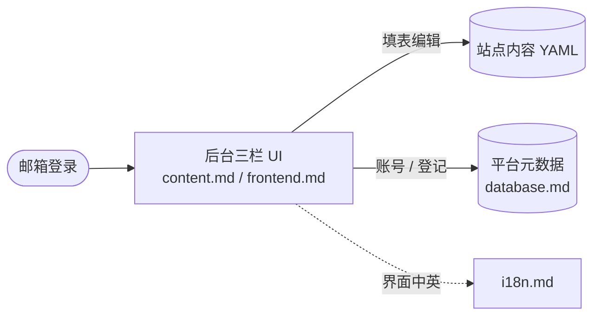

# dashboard —— 后台与数据层

用户登录后操作的管理后台，以及它背后的平台数据。

## 文档

### 概述

| 文档 | 讲什么 |
|---|---|
| [frontend.md](frontend.md) | 后台前端实现：Flask + Jinja2，三栏布局、CSS、JS 架构 |
| [content.md](content.md) | 用户后台 UI：内容管理界面（导航、表单、帮助、发布前检查） |
| [i18n.md](i18n.md) | 后台界面多语言（中 / 英，Flask-Babel） |
| [database.md](database.md) | 平台级元数据：4 张表 ER 图（账号 / 站点 / 主题 / 登录 token） |

### 页面模板

| 文档 | 讲什么 |
|---|---|
| [base.html.md](base.html.md) | 后台外壳：顶栏、三栏布局、颜色变量注入、侧栏收缩、CSRF 包装 |
| [auth/login.html.md](auth/login.html.md) | 邮箱登录：魔法链接流程、CSRF 保护 |
| [admin/users.html.md](admin/users.html.md) | 平台管理员：用户列表、角色标签 |
| [pages/](pages/) | dashboard 页面模板文档（9 个页面 + panel 机制），详见 [pages/README.md](pages/README.md) |

## 工作流

