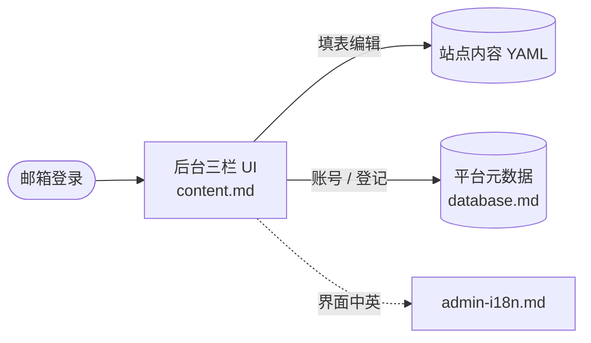

# dashboard —— 后台与数据层

用户登录后操作的管理后台，以及它背后的平台数据。

## 文档

| 文档 | 讲什么 |
| --- | --- |
| [content.md](content.md) | 用户后台 UI：内容管理界面（三栏、表单、帮助、发布前检查） |
| [admin-i18n.md](admin-i18n.md) | 后台界面多语言（中 / 英，Flask-Babel） |
| [database.md](database.md) | 平台级元数据：4 张表 ER 图（账号 / 站点 / 主题 / 登录 token） |

## 工作流

