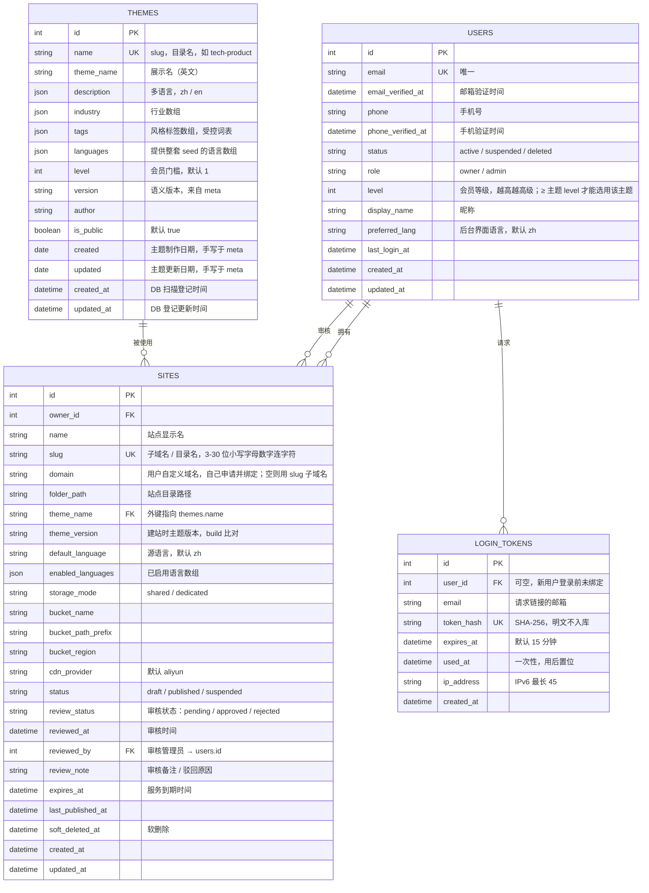

# 数据库（平台级元数据）

数据库只存**平台级元数据**——账号、站点登记、主题登记、登录 token，仅此 4 张表（SQLAlchemy）。
网站内容（设置 / 页面 / 数据集 / 翻译 / 资源）不进数据库，全部存磁盘 YAML，结构见 [sites.md](../site/sites.md)。

## 一、四张表（ER 图）

要点：

- **登录**：无密码列（只用魔法链接）。
  - `token_hash` 存哈希，明文不入库；
  - `LoginToken.user_id` 可空——新用户先用 `email` 发链接，登录后再绑定 `User`。
- **Site 标识**：
  - `slug`：全局唯一的子域名 / 目录名（建站后 1 个月内不可改）；
  - `name`：可改的显示名；`id` 仅内部主键；
  - `theme_name`：外键指向 `themes.name`（主题 slug）。
- **审核 / 域名 / 到期**（均为 `Site` 字段）：
  - `review_status`：平台对站点内容的审核——pending / approved / rejected；
  - `reviewed_by`：指向管理员（`users.role = admin`）；`review_note` 记驳回原因；
  - `domain`：用户自己申请并绑定的自定义域名（证书 / 绑定自动化走后期 `domains` 表，见 §二）；
  - `expires_at`：服务到期时间。
- **账号联系方式**：
  - `User.email`：登录主键（魔法链接）；
  - `User.phone`：手机号（联系 / 后续实名或通知用）。
- **用户权限**：
  - `User.role`：平台角色（owner / admin）；
  - `User.level`：会员等级，与主题 `level` 比较决定可选用哪些主题（[meta.yaml.md](../themes/meta.yaml.md) §四）；
  - 能开几种语言等配额由 `level` 决定，**分级待定**（[i18n.md](../i18n.md) §〇）；
  - 计费 / 到期不在 `User`，按站点走 `Site.expires_at`。
- **主题多值字段**：
  - `industry` / `tags` / `languages`：数组（JSON 列）；
  - `description`：多语言（zh / en，JSON 列）。
- **两种时间**（主题）：
  - `created` / `updated`：手写在 `meta.yaml` 的制作 / 更新日期；
  - `created_at` / `updated_at`：DB 扫描登记时间。
- **写入时机**：主题在管理员上传 ZIP 时由 `meta.yaml` 解析写入；字段逐项说明见 [themes/meta.yaml.md](../themes/meta.yaml.md)。

## 二、后期表（暂未实现）

自定义域名 / SSL 自动化上线后会增加云资源自动化相关的表（`domains`、`provisioning_jobs` 等），属基础设施层，后期再设计。MVP 阶段不建。

## 三、代码现状（与本文目标的差异）

本文（含上面的 ER 图）是**目标 schema**。代码 [app/core/models.py](../../app/core/models.py) 尚未对齐，差异已记入 [TODO-code.md](../TODO-code.md)：

- 主题表模型仍叫 `Template`（表名 `templates`），待改 `Theme` / `themes`；`Site.template_name` / `template_version` 待改 `theme_*`。
- 主题表缺 `languages` / `level` / `tags` / `author` 字段；`industry` 现为单值字符串（目标为数组）；`description` 等多语言 / 多值字段的 JSON 存法待定。
- 表由 `db.create_all()` 启动时建（[app/__init__.py](../../app/__init__.py)），**无迁移文件**；字段定稿后再决定迁移方式。
