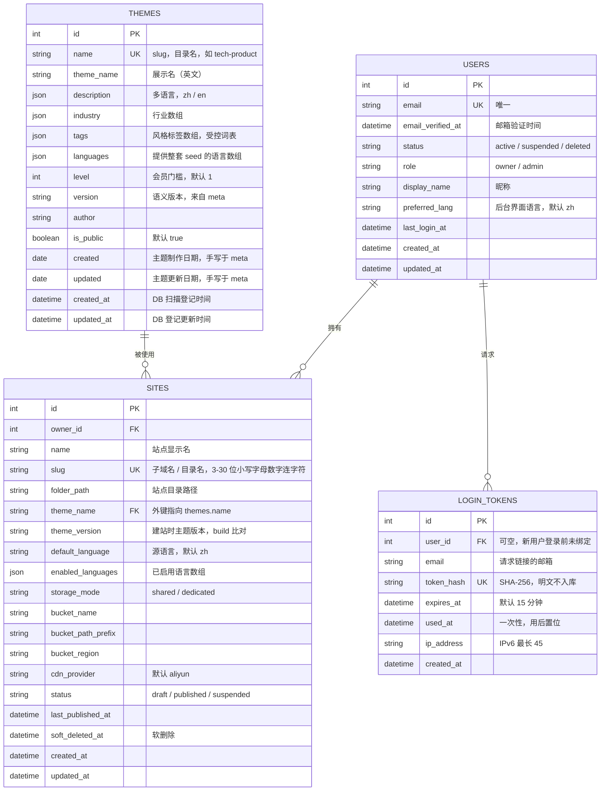

# 数据库（平台级元数据）

数据库只存**平台级元数据**——账号、站点登记、主题登记、登录 token，仅此 4 张表（SQLAlchemy）。
网站内容（设置 / 页面 / 数据集 / 翻译 / 资源）不进数据库，全部存磁盘 YAML，结构见 [data-model.md](data-model.md)。

## 一、四张表（ER 图）

要点：

- **登录**：无密码列（只用魔法链接）；`token_hash` 存哈希，明文不入库；`LoginToken.user_id` 可空——新用户先用 `email` 发链接，登录后再绑定 `User`。
- **Site 标识**：`slug` 是全局唯一的子域名 / 目录名（建站后 1 个月内不可改）；`name` 是可改的显示名；`id` 仅内部主键。`theme_name` 外键指向 `themes.name`（主题 slug）。
- **数组 / 多语言字段**：`themes.industry` / `tags` / `languages` 是数组，`description` 多语言（zh / en），均以 JSON 列存。
- **两种时间**：`themes.created` / `updated` 是手写在 `meta.yaml` 的主题制作日期；`created_at` / `updated_at` 是 DB 扫描登记时间，二者不同。
- 主题在管理员上传 ZIP 时由 `meta.yaml` 解析写入；字段逐项说明见 [themes/meta.yaml.md](themes/meta.yaml.md)。

## 二、后期表（暂未实现）

自定义域名 / SSL 自动化上线后会增加云资源自动化相关的表（`domains`、`provisioning_jobs` 等），属基础设施层，定义与用途见 [infrastructure.md](infrastructure.md)。MVP 阶段不建。

## 三、代码现状（与本文目标的差异）

本文（含上面的 ER 图）是**目标 schema**。代码 [app/core/models.py](../app/core/models.py) 尚未对齐，差异已记入 [TODO-code.md](TODO-code.md)：

- 主题表模型仍叫 `Template`（表名 `templates`），待改 `Theme` / `themes`；`Site.template_name` / `template_version` 待改 `theme_*`。
- 主题表缺 `languages` / `level` / `tags` / `author` 字段；`industry` 现为单值字符串（目标为数组）；`description` 等多语言 / 多值字段的 JSON 存法待定。
- 表由 `db.create_all()` 启动时建（[app/__init__.py](../app/__init__.py)），**无迁移文件**；字段定稿后再决定迁移方式。
