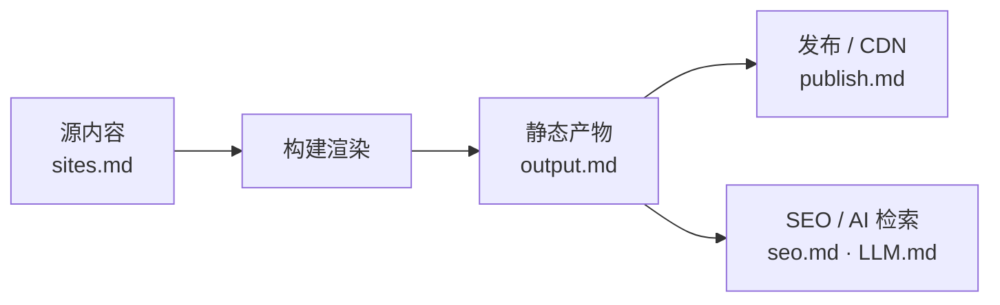

# site —— 一个用户站点（源 → 产物 → 发布）

一个用户站点从源内容到上线的全过程：填内容 → 构建成静态站 → 发布 → SEO / AI 检索优化。

## 文档

| 文档 | 讲什么 |
| --- | --- |
| [sites.md](sites.md) | 站点源内容模型：`sites/<name>/` 的 settings / pages / data |
| [output.md](output.md) | 生成的静态站：目录结构、页面 URL、列表 / 详情渲染策略 |
| [publish.md](publish.md) | 发布：资源语言策略、字体 / 图片优化、CDN、自定义口子 |
| [seo.md](seo.md) | SEO + AI 检索（sitemap、hreflang、llms.txt 等） |
| [LLM.md](LLM.md) | LLM / AI 爬虫检索优化（占位，待补） |

## 工作流

